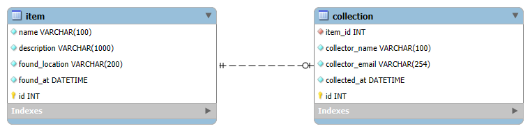

# Achados & Perdidos Insper

API REST de achados e perdidos do campus Insper, desenvolvida como projeto individual da disciplina de **Megadados**, no quinto semestre de Ciência da Computação.

## Endpoints

`GET /` retorna:

```json
{"mensagem": "Achados & Perdidos API"}
```

### Itens

O cadastro de itens encontrados oferece as seguintes operações:

| Método | Rota | Operação | Sucesso |
| --- | --- | --- | --- |
| POST | `/itens` | Cadastrar item | 201 |
| GET | `/itens` | Listar itens | 200 |
| GET | `/itens/{id_item}` | Consultar item | 200 |
| PUT | `/itens/{id_item}` | Atualizar todos os dados do item | 200 |
| DELETE | `/itens/{id_item}` | Excluir item | 204, sem corpo |

A listagem aceita `deslocamento` (padrão 0) e `limite` (padrão e máximo 100), com resultados ordenados por identificador. Itens inexistentes retornam 404, e dados inválidos retornam 422.

Exemplo de corpo para cadastro e atualização completa:

```json
{
  "nome": "Garrafa de água",
  "descricao": "Garrafa azul com tampa preta",
  "local_encontrado": "Biblioteca",
  "encontrado_em": "2026-10-25T10:30:00"
}
```

Todos esses campos são obrigatórios. Os textos têm espaços removidos das extremidades e não podem ficar vazios. Os limites são 100 caracteres para `nome`, 1000 para `descricao` e 200 para `local_encontrado`. A data usa o horário local de São Paulo, sem indicação de fuso horário. O banco gera o `id`, e a API rejeita campos adicionais nas requisições.

### Retiradas

| Método | Rota | Operação | Sucesso |
| --- | --- | --- | --- |
| POST | `/retiradas` | Registrar retirada | 201 |
| GET | `/retiradas` | Listar retiradas | 200 |
| GET | `/retiradas/{id_retirada}` | Consultar retirada | 200 |
| PUT | `/retiradas/{id_retirada}` | Atualizar todos os dados da retirada | 200 |
| DELETE | `/retiradas/{id_retirada}` | Excluir retirada | 204, sem corpo |

Exemplo de corpo para registro e atualização completa:

```json
{
  "id_item": 1,
  "nome_retirante": "Maria Silva",
  "email_retirante": "maria.silva@al.insper.edu.br",
  "retirado_em": "2026-10-25T14:00:00"
}
```

Todos os campos são obrigatórios. O nome tem limite de 100 caracteres e não pode ficar vazio após a remoção de espaços nas extremidades. O e-mail deve ser válido e ter até 254 caracteres. A data segue o mesmo formato e horário local dos itens. O banco gera o `id`, e campos adicionais são rejeitados.

A listagem usa os mesmos parâmetros `deslocamento` e `limite` dos itens, com resultados ordenados por identificador. Retiradas ou itens inexistentes retornam 404; dados inválidos retornam 422.

Cada retirada deve apontar para um item existente, e cada item pode ter no máximo uma retirada. Essas regras são garantidas por chave estrangeira e restrição de unicidade no MySQL. Tentar registrar duas retiradas para o mesmo item retorna 409. A atualização pode vincular a retirada a outro item existente que ainda não tenha retirada.

Um item com retirada registrada não pode ser excluído: a API retorna 409. Excluir a retirada mantém o item e permite registrar uma nova retirada ou excluir o item.

## Modelo de dados

Os campos JSON em português são mapeados pelo SQLModel para as colunas abaixo.




## Tecnologias

- Python 3.14
- FastAPI e Uvicorn
- SQLModel e PyMySQL
- pydantic-settings para leitura das variáveis de ambiente
- MySQL 8.4 via Docker Compose
- uv para gerenciamento de dependências

## Execução

Com Python 3.14, uv e Docker Compose instalados, prepare o ambiente:

```bash
uv sync
cp .env.example .env
```

Edite o `.env` e substitua as senhas de exemplo em `MYSQL_PASSWORD` e `MYSQL_ROOT_PASSWORD`. O arquivo `.env` é ignorado pelo Git.

Inicie o banco e a API:

```bash
docker compose up -d --wait mysql
uv run uvicorn app.main:app --reload
```

O mesmo comando de inicialização do servidor está disponível por meio de `just run`.

Na inicialização, a API cria as tabelas de itens e retiradas caso elas ainda não existam. A documentação interativa está disponível em `http://127.0.0.1:8000/docs`.

O MySQL fica disponível em `127.0.0.1:3306`. A porta pode ser alterada em `MYSQL_PORT`. Os dados são armazenados no volume `mysql_data` e preservados ao parar o contêiner com `docker compose stop mysql`.

As credenciais do `.env` são aplicadas na primeira inicialização do volume. Alterar o arquivo depois disso não altera os usuários e senhas já criados no MySQL.

## Testes

Com o MySQL iniciado, execute:

```bash
uv run python -m unittest discover -s tests -v
```

Os testes verificam a conexão com o MySQL, os CRUDs de itens e retiradas, paginação, validação de dados, integridade dos vínculos, conflitos e acesso à documentação. Os registros usados nos testes do CRUD são revertidos ao final de cada teste.

## Uso de IA

O OpenAI Codex foi utilizado para interpretar os requisitos do projeto, gerar códigos e editar a documentação.
